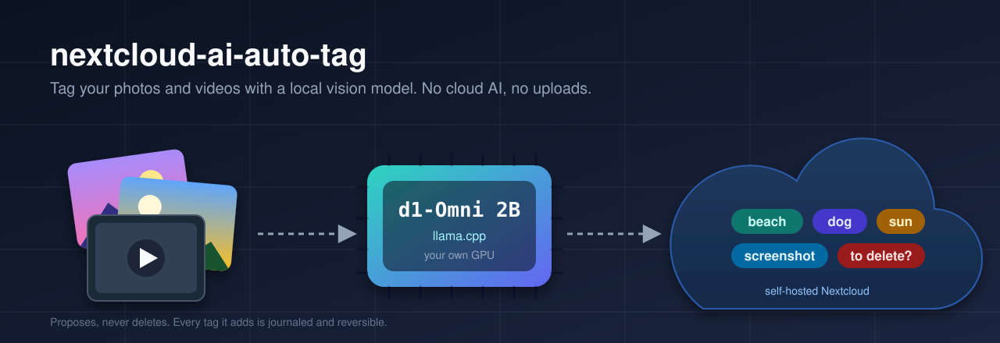

<p align="center">
  
</p>

# nextcloud-ai-auto-tag

**Automatically tag the photos and videos in your self-hosted Nextcloud with a small vision model that runs on your own GPU.** Nothing leaves your network: the originals are read over SFTP, analysed locally by [Liquid AI](https://huggingface.co/LiquidAI)'s `d1-Omni-2B` served by [llama.cpp](https://github.com/ggml-org/llama.cpp), and the result is written back as ordinary Nextcloud *system tags* over WebDAV.

It also flags **candidates for deletion** (blurry or accidental shots, near-duplicates, screenshots) with a dedicated tag, always with a reason, and **never deletes anything**.

> **Status:** working, and used on a real library of about 40,000 files. The default tag vocabulary (`config/tags.yaml`) and the command-line messages are in French; the code, configuration and this README are in English. Translating the vocabulary is a one-file edit, and i18n contributions for the CLI are welcome.

## Why

- Tagging apps for Nextcloud run heavy models on the server. Here the server stays untouched: the GPU work happens on a desktop machine.
- `d1-Omni-2B` is a *decision model*: it does not chat, it answers typed questions with calibrated probabilities in a single forward pass. That makes tagging fast, deterministic and threshold-friendly.
- Tags are plain Nextcloud system tags, so they work with the Files app, search and filters, without any plugin.

## How it works

```
 Nextcloud (WebDAV)  --inventory-->  state.db (SQLite)
 Server disk (SFTP)  --originals-->  resize / extract frames (Pillow, ffmpeg)
                                       |
                                       v
                        llama-server  +  d1-Omni-2B  (local GPU)
                                       |
              content gate -> categories (choice) + yes/no questions
              + quality checks (blur, black frame) + duplicate hashes
                                       |
                                       v
                dry-run report  --apply-->  Nextcloud system tags (journaled)
```

1. **Inventory** (read-only): a WebDAV `SEARCH` lists images and videos per account with their `fileid` and `etag`, so only new or changed files are processed.
2. **Fetch**: originals are read over SFTP straight from the Nextcloud data directory (fast, no PHP involved). Images are downscaled in memory; videos are sampled into frames with `ffmpeg`.
3. **Inference**: `d1-Omni-2B` answers a handful of questions defined in [`config/tags.yaml`](config/tags.yaml). A *gate* question first detects screenshots and documents and stops early. Because the image is re-encoded for every question, the taxonomy favours about ten `choice` questions (one per category) over dozens of yes/no questions.
4. **Quality and duplicates**: a Laplacian-variance blur test combined with the model, a black-frame test, and 64-bit perceptual hashes (dHash) to group near-duplicates and keep the sharpest copy.
5. **Apply** (explicit `--apply`): missing tags are created once and assigned per file with the owner's credentials, and **every assignment the tool adds is journaled**. Tags that were already on a file (added by hand, for example) are never recorded and never removed.

Measured on a Radeon RX 6950 XT (Vulkan): about 1.7 s per photo with 12 questions at 768 px (about 1.4 s at 512 px). Throughput is bound by GPU compute, so extra parallel requests or a second server instance do not help.

## Safety

- `run` is a **dry run by default**. Nothing is written to Nextcloud without `--apply`.
- The tool **never deletes files and never deletes tags**. The deletion-candidate tag (default name `à supprimer`, see `delete_tag_name` in the settings) only marks candidates, with a reason (`floue`/blur, `accident`, `doublon`/duplicate, `capture`/screenshot) that you can review with `report --delete-candidates`.
- `rollback --yes` removes **only** the assignments recorded in the journal.
- Writes are paused during configurable blackout windows (for example your backup window) and retried when Nextcloud answers 503 (maintenance mode).
- Credentials are Nextcloud **app passwords**, read from the Windows Credential Manager (target `nc-autotag:<user>`) or from environment variables. They are never logged.

## Requirements

- Python 3.15 and [uv](https://docs.astral.sh/uv/)
- [llama.cpp](https://github.com/ggml-org/llama.cpp) **b11960 or newer** (`llama-server`), built for your GPU (CUDA, Vulkan, Metal...)
- Models from Hugging Face: [`LiquidAI/d1-Omni-2B-GGUF`](https://huggingface.co/LiquidAI/d1-Omni-2B-GGUF) (`d1-Omni-2B-Q8_0.gguf` and `mmproj-d1-Omni-2B-Q8_0.gguf`)
- `ffmpeg` and `ffprobe` in `PATH` (video frames)
- A Nextcloud server you control: SSH key access to read the data directory, and one app password per account
- Windows is the tested platform (credential store, PowerShell scripts); the Python core is portable

## Quick start

```bash
git clone https://github.com/laurentvv/nextcloud-ai-auto-tag.git
cd nextcloud-ai-auto-tag
uv sync

cp config/settings.example.toml config/settings.toml   # edit URL, users, SSH, model paths
# store one app password per user in the Credential Manager (target nc-autotag:<user>)
# or export NC_AUTOTAG_PASSWORD_<USER>

# start the model server (the nightly script can also do it for you)
llama-server -m d1-Omni-2B-Q8_0.gguf --mmproj mmproj-d1-Omni-2B-Q8_0.gguf \
  -b 8192 -ub 8192 -ngl 99 --host 127.0.0.1 --port 8080

uv run nc-autotag doctor            # credentials, WebDAV, SSH, models, ffmpeg
uv run nc-autotag inventory         # read-only
uv run nc-autotag describe-local ./some/photos/*.jpg           # try the pipeline locally
uv run nc-autotag run --user alice --path /Photos --limit 50   # dry run
uv run nc-autotag report --delete-candidates --csv reports/candidates.csv
uv run nc-autotag run --user alice --path /Photos --limit 50 --apply
uv run nc-autotag rollback --run 3 --yes                       # undo exactly what run 3 added
```

With Git Bash on Windows, prefix commands that take absolute-looking paths such as `/Photos` with `MSYS_NO_PATHCONV=1`.

## Commands

| Command | What it does |
|---|---|
| `doctor` | Checks credentials, WebDAV, SSH, llama.cpp files and server, ffmpeg |
| `inventory` | Lists images and videos per account (read-only) and updates the local state |
| `run` | Analyses pending files (dry run); `--apply` writes tags. Options: `--user`, `--path`, `--exclude-path`, `--limit`, `--until`, `--reprocess`, `--no-delete-tag` |
| `status` | Files per account and status, journaled assignments, recent runs |
| `report` | Proposed tags, including deletion candidates with the reason and the duplicate that was kept (`--csv`) |
| `rollback` | Removes only journaled assignments (`--run`, `--user`, requires `--yes`) |
| `describe-local` | Runs local files through the pipeline without touching Nextcloud |
| `make-labels` / `eval` | Writes a CSV to label by hand, then computes per-tag precision/recall and the F1-optimal threshold |
| `duplicates` | Finds near-duplicates in a local folder |
| `config-show` | Prints non-secret settings for scripts |

## Customising the tags

Edit [`config/tags.yaml`](config/tags.yaml): categories of kind `choice` (one question, one winner, with an automatic `aucun`/none option) or `noul` (independent yes/no tags), per-category and per-tag thresholds, and optional `emit` / `also` fields that map several options to one Nextcloud tag. Each tag has an English `description` that is used as the criterion shown to the model. Use `make-labels` and `eval` on a small hand-labelled sample to choose thresholds from real data instead of guessing.

## Nightly sessions

`scripts/nuit.ps1` and `scripts/install-taches.ps1` (PowerShell 7) run a bounded nightly session: an incremental pass for new files, then a dry-run analysis of large archives until a cut-off time, with a lock, logs and an automatic stop before your backup window. See [docs/seances-de-nuit.md](docs/seances-de-nuit.md) (in French).

## Development

```bash
uv sync
uv run pytest        # runs offline: Nextcloud is mocked, no GPU required
uv run ruff check .
```

## License

Code: [MIT](LICENSE).
The Liquid AI models are distributed under their own terms (LFM Open License v1.0): check them before any commercial use. This project is not affiliated with Nextcloud GmbH, Liquid AI or the llama.cpp project; "Nextcloud" is a trademark of its owner.
